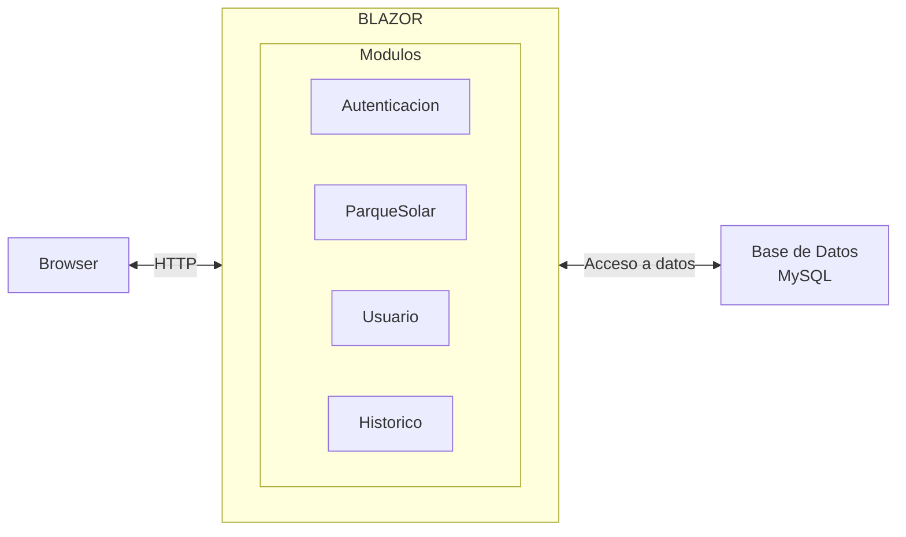
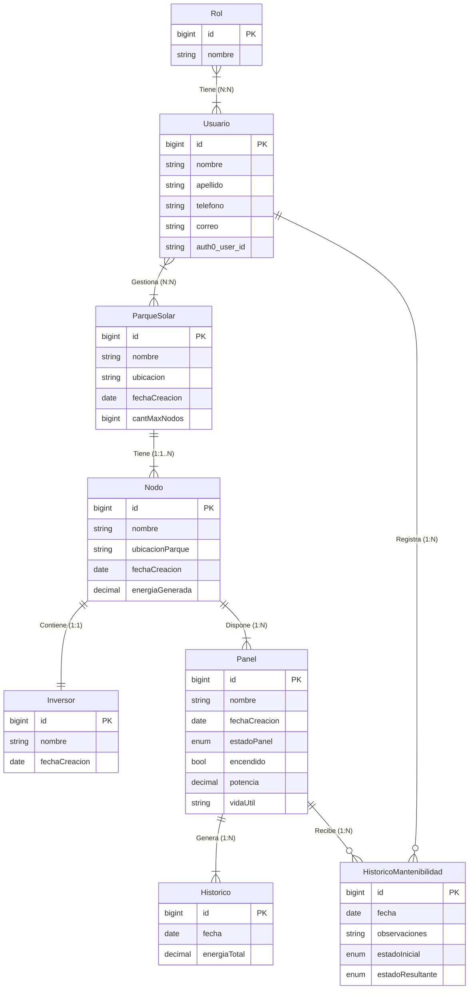

# Gestión de Parques Solares - Taller de Programación .NET

## 1. Introducción
Uruguay se ha posicionado como líder en energías renovables con la incorporación de nuevos parques solares a su matriz energética. Para que estas instalaciones funcionen de manera eficiente, es fundamental contar con sistemas de software que permitan operarlas y monitorearlas. 

En este contexto, el presente proyecto se desarrolla dentro del Taller de Programación .NET con el objetivo de construir una prueba de concepto para la gestión de parques solares, aplicando tecnologías de .NET y profundizando en las decisiones de diseño y arquitectura del sistema.

---

## 2. Decisiones de diseño y tecnología

### Tecnología a utilizar: ASP.NET Core Blazor
Elegimos ASP.NET Core Blazor principalmente porque nos permite usar C# para todo, tanto en el cliente (frontend) como en el servidor (backend). De esta forma, nos ahorramos tener que estar cambiando constantemente entre JavaScript y .NET. 

Esta tecnología también nos da la libertad de elegir cómo ejecutar la aplicación (ya sea con Blazor Server o WebAssembly) y nos ayuda a mantener el proyecto muy bien organizado con la arquitectura monolítica modular, la cual organiza el sistema en bloques independientes donde cada módulo encapsula sus propias pantallas y lógica de negocio. 

Por último, es la herramienta con la que más practicamos durante el curso. Al ser una tecnología que el equipo ya conoce y domina, no perdemos tiempo desarrollando con otra tecnología en la que capaz no nos sentimos tan cómodos.

### Arquitectura a utilizar: Monolito modular
La elección de una arquitectura monolítica modular nos permite marcar límites de dominio claros. Al encapsular los datos, la lógica de negocio y la interfaz de usuario en módulos independientes, evitamos que el código se vuelva desordenado e inmantenible. 

Otra cosa importante a tener en cuenta es que la comunicación entre módulos se realiza directamente en memoria utilizando interfaces de C# e inyección de dependencias, lo que elimina por completo la sobrecarga de red. Además, esta separación limpia facilita el desarrollo en paralelo, permitiendo que varios integrantes del equipo trabajen en distintos módulos de forma simultánea sin generar conflictos de código.

---

## 3. Diagrama de Arquitectura

---

## 4. Diagrama Modelo Entidad Relación (MER)

### Notas

- `Usuario.auth0_user_id` es el identificador del usuario en Auth0 (`user_id`, con formato `auth0|xxxx`). Es el vinculo con el proveedor de identidad: la contrasena **no** se guarda en esta base, la administra Auth0.
- Los roles se replican tambien en Auth0 (rol `Administrador`, `Mantenimiento`) para que el claim `https://solaryu.com/roles` del token permita autorizar las operaciones.

## 5. Conclusiones de la metodologia de desarrollo con IA.
- Problemas futuros relacionados a la mantenibilidad: Se comentó entre los integrantes del equipo y se llegó a la conclusión de que el código escrito por la IA puede ser leido y aprobado pero presenta la dificultad de que no se termina de recordar los detalles de la implementación. Es decir si bien el código puede ser leido a la hora de necesitar la intervención humana pasado un tiempo posiblemente requiera una lectura nuevamenta, a diferencia del código escrito a mano el cual se suele recordar con mayor facilidad y por mas tiempo.
- Sensación de trabajar en una caja negra: Relacionado al punto anterior, si bien el código puede ser leido y aprobado por una persona antes de ser subido al repositorio sigue estando esa sensación de que la persona pierde un poco el control sobre lo que se esta haciendo.
- Discrepancias con el agente: Si no se es extremadamente especifico en el prompt. Si bien las funcionalidades se solicitan haciendo uso de unos .md que tienen las instrucciones para realizar la funcionalidad, si no se es extremadamente especifico en el prompt inicial el agente suele a tomar decisiones por su cuenta haciendo que el código entregado no cumpla con lo deseado.
- Solución a las discrepancias: A la hora de trabajar con esta metodología se optó por algunas partes de trabajar con un branch local de pruebas. Esto con el objetivo de que si ocurre algo como el problema mencionado en el punto anterior se puede revertir el código hecho por el agente facilmente.

## 6. Uso de Sonarqube
A la hora de realizar un scan del código con Sonarqube la mayoría de problemas se dividían en dos catégorias: los que eran señalados por la falta de control sobre variables que podían ser nulas. Y los que se marcaban como problemas de mantenibilidad, a estas advertencias de Sonarqube si bien se revisaron se optó por no tratar de corregirlas por una cuestión de que se trata de una prueba de concepto y no un producto final en si. Esto significa que si el día de mañana el proyecto recibiera luz verde para salir a producción se tendría que trabajar en arreglar esos detalles o por su otra parte lo que se realiza en muchos casos en la cual se utiliza esta metodología la cual es reescribir el programa pero con una base limpia y con mayor participación humana a la hora de escribir código.