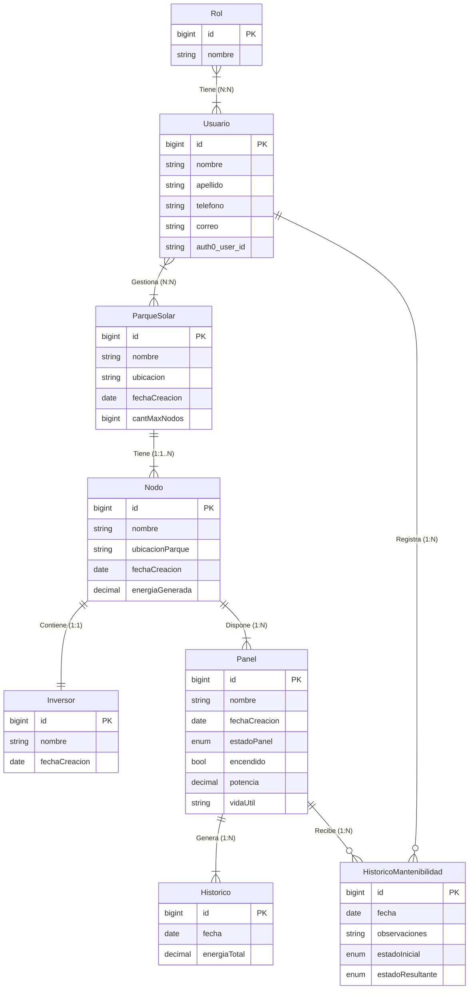

## Notas

- `Usuario.auth0_user_id` es el identificador del usuario en Auth0 (`user_id`, con formato `auth0|xxxx`). Es el vinculo con el proveedor de identidad: la contrasena **no** se guarda en esta base, la administra Auth0.
- Los roles se replican tambien en Auth0 (rol `Administrador`, `Mantenimiento`) para que el claim `https://solaryu.com/roles` del token permita autorizar las operaciones.