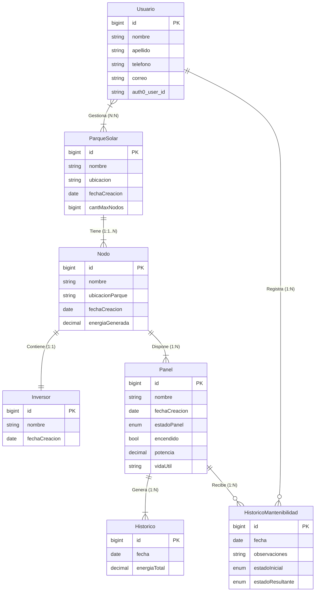

## Notas

- `Usuario.auth0_user_id` es el identificador del usuario en Auth0 (`user_id`, con formato `auth0|xxxx`). Es el vinculo con el proveedor de identidad: la contrasena **no** se guarda en esta base, la administra Auth0.
- No existe una tabla local de roles ni una relacion `Usuario-Rol` en la base de datos. Auth0 es la fuente unica de identidad, roles y permisos: los roles (`Administrador`, `Mantenimiento`) y sus permisos se administran en el tenant y se asignan a cada usuario mediante la Management API.
- El backend valida los Access Tokens JWT de Auth0 (firma, emisor y audiencia) y autoriza las operaciones con politicas de ASP.NET Core basadas en el claim `permissions` (`users:read`, `users:create`, `users:update`, `users:delete`).
- La base local solo conserva los datos propios del negocio (identificador interno, `auth0_user_id`, nombre, apellido, correo y telefono).
- En la interfaz web, los permisos del Access Token y los roles del usuario se agregan a la cookie de autenticacion al iniciar sesion. En las APIs con token, los permisos ya viajan en el Access Token validado.
